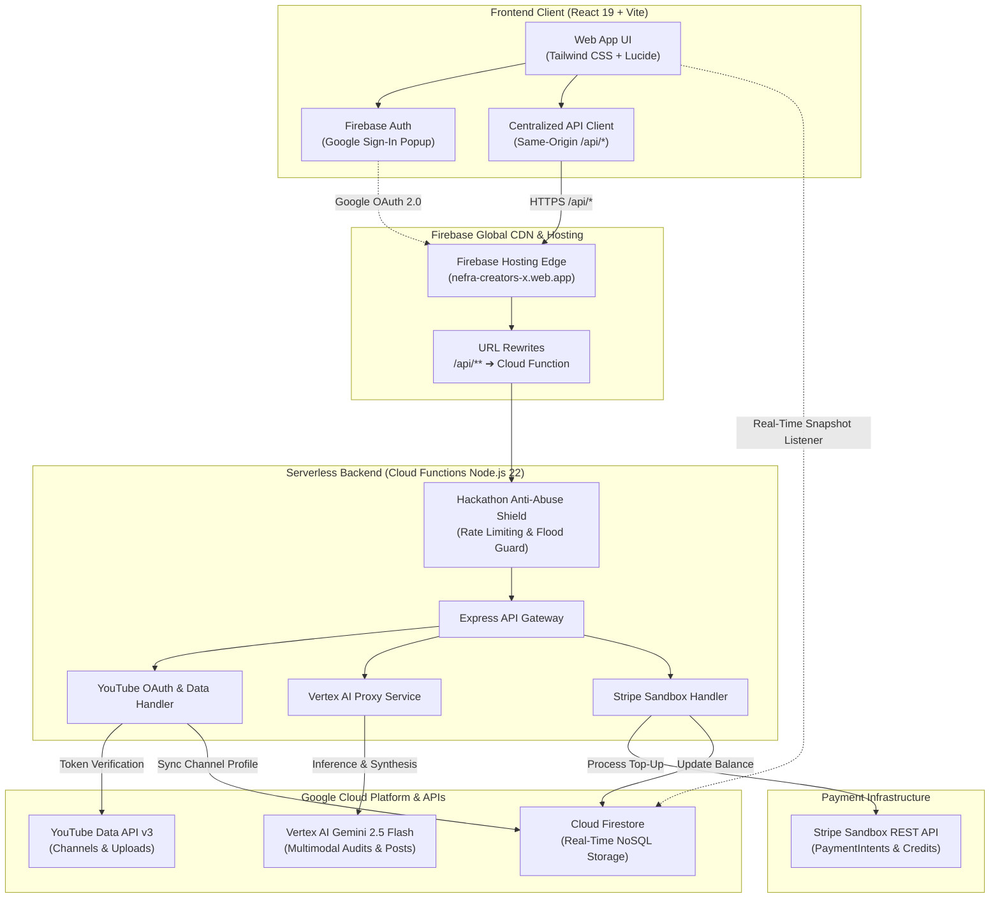

# NEFRA CREATORS
### AI-Powered Creator Intelligence, Zero-Spoof YouTube Verification & Escrow Platform

> **Live Application**: [https://nefra-creators-x.web.app](https://nefra-creators-x.web.app)  
> **Backend Cloud Functions**: `https://us-central1-nefra-creators-x.cloudfunctions.net/api`

---

## 📖 Overview

**NEFRA CREATORS** is an AI creator intelligence and escrow collaboration platform that bridges the trust gap between content creators and enterprise brands. 

Traditional influencer marketing is plagued by inflated vanity metrics, unverified screenshots, and payment distrust. NEFRA eliminates these friction points by uniting:
1. **Zero-Spoof Channel Verification**: Direct Google OAuth 2.0 (`youtube.readonly`) integration querying official YouTube Data API v3 metrics server-side.
2. **Multimodal AI Channel Audits**: Deep audience intelligence, commercial rate cards, and engagement trajectory powered by **Google Cloud Vertex AI (Gemini 2.5 Flash)**.
3. **AI Content Studio**: Audience-tuned community post synthesis and campaign briefs with built-in creator dignity guardrails.
4. **Milestone Escrow & Credit Wallet**: Safe financial transactions powered by Stripe sandbox payments.

---

## System Architecture



---

## Core Features

### 1. Zero-Spoof YouTube Channel Verification
- Creators link their authentic channel with a single Google OAuth 2.0 popup (`youtube.readonly`).
- Channel statistics (verified subscriber count, total views, playlist uploads) are pulled directly from Google’s YouTube Data API v3.
- Manual handle spoofing and fake follower inflation are technically impossible.

### 2. Multimodal Channel Auditor (Powered by Vertex AI)
- Evaluates recent video uploads, audience demographics, niche category alignment, and historical retention curves.
- Computes an objective **Nefra AI Creator Score (0–100)** and suggests dynamic, data-driven commercial rate cards for brand partnerships.

### 3. AI Content Studio & Campaign Creator
- Generates high-impact YouTube Community Posts, visual copies, and sponsor proposals.
- **Dignity Guardrail Sanitizer**: Enforces a strict zero-defamation policy that prevents disparagement of creators' personal attributes, language, or accents, reframing all critiques into actionable market insights.

### 4. Creator Wallet & Milestone Escrow
- Brands and creators fund agreements securely via Stripe Sandbox payment intents.
- Escrow funds are locked and automatically disbursed upon verifiable milestone completions.

---

## Google Cloud & Firebase Technologies

| Service | Role in NEFRA |
| :--- | :--- |
| **Google Cloud Vertex AI** | Multimodal video critiques, category classifications, and AI community post copy synthesis via Gemini 2.5 Flash. |
| **YouTube Data API v3** | Official server-side metric verification (channel ID, subscriber count, video metrics). |
| **Firebase Cloud Functions** | Serverless Node.js 22 runtime handling OAuth verification, API proxies, and anti-abuse safeguards. |
| **Cloud Firestore** | Real-time synchronization of creator accounts, AI post history, and campaign states. |
| **Firebase Authentication** | Identity management with Google OAuth sign-in and COOP popup policies. |
| **Firebase Hosting** | Global edge distribution with same-origin rewrites (`/api/**` → Cloud Functions) eliminating CORS overhead. |

---

## Getting Started

### Prerequisites
- Node.js (v20+ or v22+)
- npm or yarn

### 1. Clone & Install
```bash
git clone https://github.com/tksoftstudios/NEFRA-CREATORS.git
cd NEFRA-CREATORS
npm install
```

### 2. Environment Configuration
Copy `.env.example` to `.env` and fill in your keys:
```bash
cp .env.example .env
```

### 3. Run Locally
```bash
# Start Vite development server
npm run dev
```
Open [http://localhost:5173](http://localhost:5173) in your browser.

---

## Production Deployment

Deploy both the frontend SPA and the Cloud Functions backend with a single command:

```bash
npm run deploy
```

This script:
1. Runs `vite build` to optimize client bundles into `dist/`.
2. Packages server handlers and dependencies into `functions/`.
3. Deploys Firebase Hosting and Cloud Functions to project `nefra-creators-x`.
