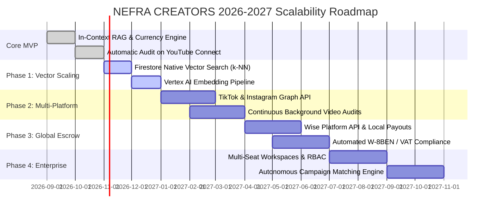

# NEFRA CREATORS — Global Architecture & Scalability Roadmap
**Platform Vision**: Transforming the Creator Economy through Google Cloud Vertex AI Multimodal Diagnostics, Cloud Firestore Native Vector Search, and Multi-Currency Pre-Funded Escrow Governance.

---

## Executive Summary
NEFRA CREATORS is built to replace slow, opaque talent agencies with an automated, transparent, and globally accessible marketplace. By combining **Google Cloud Vertex AI** for authentic multimodal channel audits with a **state-machine governed escrow financial engine**, NEFRA protects both creators and global brands.

This roadmap details the engineering and commercial architecture required to scale NEFRA from regional MVP to a planetary-scale creator infrastructure supporting millions of creators and multi-billion-dollar brand campaigns.

---

```
                                  GLOBAL NEFRA ARCHITECTURE
                                  
  ┌────────────────────────────────────────────────────────────────────────────────────────┐
  │                               GLOBAL EDGE INGRESS (CDN / Cloudflare)                   │
  └────────────────────────────────────────────────────────────────────────────────────────┘
                                            │
                      ┌─────────────────────┴─────────────────────┐
                      ▼                                           ▼
         ┌─────────────────────────┐                 ┌─────────────────────────┐
         │   Creator Web App (PWA) │                 │   Brand Enterprise Hub  │
         │  (Vite / React / Tailwind)                │  (Next.js / SSR Analytics)│
         └─────────────────────────┘                 └─────────────────────────┘
                      │                                           │
  ────────────────────┼───────────────────────────────────────────┼─────────────────────────
                      ▼                                           ▼
  ┌────────────────────────────────────────────────────────────────────────────────────────┐
  │                         API GATEWAY & EDGE AUTH (Firebase / Envoy)                     │
  └────────────────────────────────────────────────────────────────────────────────────────┘
          │                                 │                                 │
          ▼                                 ▼                                 ▼
┌──────────────────┐              ┌──────────────────┐              ┌──────────────────┐
│  OAuth & Social  │              │ Escrow Financial │              │ Vertex AI & RAG  │
│  Ingestion Engine│              │ State Machine    │              │ Advisory Engine  │
│ (YouTube/TikTok) │              │ (Stripe/Wise/FX) │              │(Gemini/Embeddings│
└──────────────────┘              └──────────────────┘              └──────────────────┘
          │                                 │                                 │
          └────────────────────────┬────────┴─────────────────────────────────┘
                                   ▼
  ┌────────────────────────────────────────────────────────────────────────────────────────┐
  │                        MULTI-REGION DATA LAYER (Google Cloud)                          │
  │                                                                                        │
  │   ┌────────────────────────────────┐         ┌─────────────────────────────────────┐   │
  │   │  Cloud Firestore Vector Store  │         │    Cloud Pub/Sub & Cloud Run        │   │
  │   │  (k-NN / findNearest Search)   │         │    (Async Deep Video Ingestion)     │   │
  │   └────────────────────────────────┘         └─────────────────────────────────────┘   │
  └────────────────────────────────────────────────────────────────────────────────────────┘
```

---

## 1. AI Infrastructure & Global RAG Scaling

### 1.1 Transition: In-Context RAG ➔ Native Firestore Vector Search
- **Current State (MVP)**: In-Context snapshot injection passing top 12 filtered creators directly into Gemini 2.5 Flash prompts.
- **Future State (Global)**:
  - Deploy Firebase Extension **`firestore-vector-search`** paired with Vertex AI **`text-embedding-004`** (768-dimensional embeddings).
  - Every time a creator connects their channel or receives a new video audit, a Cloud Function automatically computes a dense semantic vector embedding representing:
    - Niche classification, tags, and audience demographics.
    - Video pacing style, transcript tone, and vocabulary safety.
    - Performance metrics (subscribers, 30-day view velocity, hook retention %).
  - Store embeddings in a native `VectorValue` field on the Firestore document.
  - Implement k-NN cosine similarity search via Firestore's `findNearest()` API:
    ```javascript
    const queryEmbedding = await vertexAI.getEmbedding(brandBriefQuery);
    const topCreators = await db.collection('creators')
      .where('verified', '==', true)
      .where('category', 'in', requestedCategories)
      .findNearest('embedding', queryEmbedding, {
        limit: 15,
        distanceMeasure: 'COSINE'
      })
      .get();
    ```

### 1.2 Deep Multimodal Video Auditing (Gemini 2.5 Pro)
- **Asynchronous Telemetry Ingestion Pipeline**:
  1. YouTube webhook / PubSub triggers when a creator uploads a new public video.
  2. Cloud Run worker ingests the MP4 video stream directly into Cloud Storage (`gs://nefra-telemetry-vault/`).
  3. Vertex AI Gemini 2.5 Pro processes the video natively with multimodal input (Audio transcription + Visual frame sampling at 1 fps):
     - **Hook Retention Curve**: Identifies the exact second where viewer interest drops off.
     - **Speech Pacing Analysis**: Measures words per minute (WPM) and silences.
     - **Automated Brand Safety Scoring**: Scans visuals for alcohol, hate speech, copyrighted music, and advertiser-sensitive topics.
     - **Optimal Mid-Roll Recommendation**: Detects natural narrative transitions (e.g. topic changes) to suggest exact ad timestamps.

### 1.3 NefraSense Autonomous Brand Co-Pilot
- Evolve from a conversational drawer to an autonomous decision agent capable of:
  - **Automated Roster Assembly**: Ingesting a $50,000 global budget and returning an optimized mix of 1 Mega, 3 Mid-Tier, and 5 Micro creators.
  - **Dynamic ROI Forecasting**: Predicting organic impressions, estimated conversion velocity, and customer acquisition cost (CAC).
  - **Automated Milestone Verification**: Using vision models to review creator draft videos before public release to verify brand guidelines and sponsor mentions.

---

## 2. Multi-Platform Social Ingestion

While YouTube is the gold standard for long-form search indexing and commercial integrations, global campaigns require cross-platform synergy:

| Platform | Ingestion Protocol | Key Verified Telemetry |
| :--- | :--- | :--- |
| **YouTube** | OAuth 2.0 (`youtube.readonly`) | Subscribers, Lifetime Views, 30-Day Avg Views, Video Category, Transcript Cadence |
| **TikTok** | TikTok Commercial Content API | Follower Count, 7-Day Completion Rate, Sound Virality Score, Audience Age Median |
| **Instagram** | Instagram Graph API (Business/Creator) | Verified Followers, Story Retention %, Reel Re-shares, High-Value Saves |
| **Twitch** | Twitch Helix API (`user:read:broadcast`) | CCV (Concurrent Viewers), Broadcast Hours, Chat Velocity, Stream Sentiment |
| **X (Twitter)** | X API v2 (Pro/Enterprise) | Follower Reach, Impressions per Tweet, Media Engagement, Retweet Ratios |

---

## 3. Global Financial Rails & Multi-Currency Escrow

### 3.1 Planetary Multi-Currency Clearing
- **Supported Global Currencies**:
  - Tier 1: `USD`, `EUR`, `GBP`, `JPY`, `CAD`, `AUD`, `SGD`, `CHF`
  - High-Growth Emerging Creator Markets: `LKR` (Sri Lanka), `INR` (India), `AED` (UAE), `BRL` (Brazil), `IDR` (Indonesia), `PHP` (Philippines), `NGN` (Nigeria)
- **Real-Time FX Hedging**:
  - When a brand funds escrow in USD, creators can lock their contract in their domestic currency (e.g. LKR or EUR).
  - Platform partners with Wise Platform API and Stripe Treasury to lock the spot exchange rate at contract signing, protecting creators from local currency volatility.

### 3.2 Global Payout Distribution
- **Stripe Connect Custom**: Native automated payouts across 47+ countries directly to creator checking accounts.
- **Wise Platform Direct Ingestion**: Local bank rail delivery across 70+ countries (SEPA, ACH, Faster Payments, UPI, CEFT / SLIPS) with sub-1% FX margins.
- **Crypto & Web3 Escrow Rail (Optional for Web3 Verticals)**:
  - USDC on Solana / Polygon for instant cross-border settlement with sub-cent fees.

### 3.3 Automated Tax Compliance & Global Legal Architecture
- Automated **W-8BEN** (foreign non-US individuals) and **W-9** collection upon account verification.
- Dynamic VAT, GST, and 1099-NEC generation at fiscal year-end.
- Standardized, enforceable global Master Services Agreement (MSA) with country-specific jurisdiction clauses.

---

## 4. Multi-Tenant Workspaces & Enterprise Governance

### 4.1 Enterprise Brand Workspaces
- **Role-Based Access Control (RBAC)**:
  - *Brand Owner*: Full budget clearance, contract signing, legal administration.
  - *Campaign Manager*: Brief creation, creator roster shortlisting, feedback delivery.
  - *Creative Director*: Video draft approval, milestone checklist sign-off.
  - *Finance / Billing*: Escrow top-ups, invoice downloading, multi-currency accounting.
- **Approval Chains**: Multi-signature requirement for escrow disbursements over $10,000.

### 4.2 Talent Agency & Multi-Channel Network (MCN) Portal
- Allows verified creator agencies to manage rosters of 10–500 talent profiles under a unified dashboard.
- Automated commission splitting: e.g. 80% to Creator, 20% to Agency, delivered automatically by the escrow state machine.

---

## 5. Security, Fraud Detection & Anti-Vanity Infrastructure

### 5.1 AI View-Bot Detection Engine
- Cross-references YouTube Data API video views with:
  - Like-to-view ratios (< 1.5% flags anomalous view spikes).
  - Comment semantic diversity (identifies copy-pasted bot comments).
  - Geographic consistency (flags channels where 95% of subscribers reside in regions completely disconnected from the content language).

### 5.2 Zero-Knowledge Creator Privacy
- Brands see audited demographics and performance data without exposing the creator's private legal names, home addresses, or tax IDs until a legally binding escrow contract is executed.

---

## 6. Implementation Phasing & Milestones



---

## Conclusion
By anchoring NEFRA CREATORS on verifiable Google Cloud Vertex AI multimodal diagnostics, Firestore vector intelligence, and guaranteed escrow protection, the platform eliminates counterparty risk for global marketing teams while empowering creators worldwide with standardized, data-justified commercial value.
